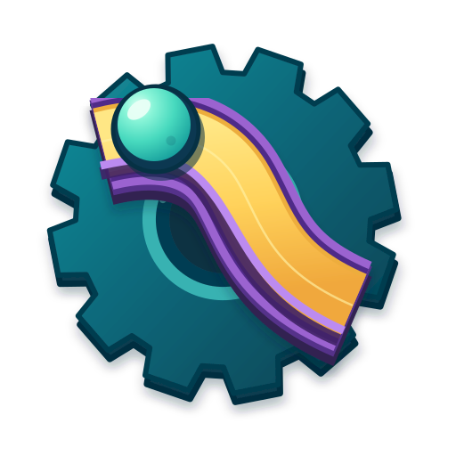

<!-- markdownlint-disable MD033 -->
#  Marble Engineer

Marble Engineer is a 3D construction and physics puzzle game about making a machine work. Connect tracks across different heights, lift marbles in a bucket elevator, or use a sensor to open a gate at the right moment. Release the marbles, watch what happens, and return to building with your layout intact.

Sandbox gives you room to experiment with an unrestricted player toolbox and personal track saves. Campaign starts with an incomplete machine: work around fixed pieces, choose how to spend a limited inventory, and meet its physical objectives. The ten Introduction puzzles are optional; you can go straight to the main campaign.

The Puzzle Editor uses the same building tools to turn your own machine into a challenge. Keep the starting layout separate from your solution, decide what the player can change, and test under those rules before publishing. Share puzzles as JSON files or browse and publish through the optional community service. Local play, authoring, and file sharing work without an account.

The game is in development.

## Run from source

Import `project.godot` in Godot **4.7**, let asset import finish, then press **F5**. The main scene is `scenes/main.tscn`. The project uses GDScript, so .NET is not required.

With Godot on your path, you can also run from the repository root:

```powershell
godot --path .
```

Keep the bundled plugins enabled. The project uses Forward Plus rendering and Jolt physics at 120 ticks per second. GodotSteam includes native libraries that must load on your platform; Steam itself may be unavailable without preventing local play. Online setup is covered in the [community service guide](docs/COMMUNITY_SERVICE.md).

## Build your first track

In Sandbox, choose a piece from the toolbox and click to place it. Point near an open connector to attach the next piece: snapping aligns its direction and height. Away from a connector, the grid and active building height guide placement. A selected track's `+` marker opens compatible extensions.

Add one marble release, extend a route, and choose **Test Track**. The release can emit several marbles. A finish catcher is optional in Sandbox; reaching one ends the run. Pause to inspect the machine, or reset to adjust the track and try again. For a more involved example, try a saved example track or read the [mechanisms guide](docs/MECHANISMS.md).

Click to select, drag to move, and Shift-click to build a selection. Dragging a box from empty space selects a group; double-clicking a track selects its connected tracks. Groups move and rotate together, and a group edit takes one undo step.

| Action | Default control |
| --- | --- |
| Rotate / duplicate / delete | R / Ctrl+D / Delete |
| Cancel or clear selection | Escape |
| Undo / redo | Ctrl+Z / Ctrl+Y or Ctrl+Shift+Z |
| Select all editable pieces | Ctrl+A |
| Cycle attachments | Tab |
| Raise / lower building height | Page Up / Page Down; Shift for finer steps |
| Save / test or pause | Ctrl+S / Space |
| Orbit / pan / zoom | Right drag / middle drag / wheel |
| Vertical pan / keyboard pan | Shift + middle drag / WASD |
| Frame selection / whole construction | F / Home |
| Toggle grid / snapping | G / C |

Settings lets you change keyboard bindings, camera, audio, and graphics options. During a run, click a visible marble or use the camera button to follow it. Stop following to return to your free camera view.

## Development

Start with [Architecture](docs/ARCHITECTURE.md) to understand the shared workspace and system boundaries. For specific work, use these guides:

- [Puzzle authoring and distribution](docs/PUZZLE_AUTHORING.md): create, test, publish, and maintain puzzles.
- [Piece authoring](docs/PIECE_AUTHORING.md): add catalog pieces, settings, behaviors, and ports.
- [UI design](docs/UI_DESIGN.md): scene layout, shared styling, input, and motion.
- [Community service](docs/COMMUNITY_SERVICE.md): backend setup, compatibility, and Steam authentication.
- [SupabaseClient addon](addons/supabase_client/README.md): the reusable Godot client, independent of the game.
- [AGENTS.md](AGENTS.md): instructions for coding agents working in this repository.

Run tests through the bundled GUT panel or from the repository root:

```powershell
godot --headless --path . --script addons/gut/gut_cmdln.gd -gexit
```

Add `-gselect=construction_groups`, for example, to select a test file by name. The suite checks system contracts, editing operations, geometry, persistence, and service behavior. [Verification guidance](docs/ARCHITECTURE.md#verification) explains save isolation and when interactive testing is also needed.

The Windows Desktop export preset writes to `build/windows/`. Install matching Godot export templates and create the output directory before using **Project → Export**. The preset includes campaign and example JSON plus public Supabase configuration, and excludes backend source. Other platforms need an export preset and compatible native dependencies.

Track models come from Kenney's Marble Kit.
